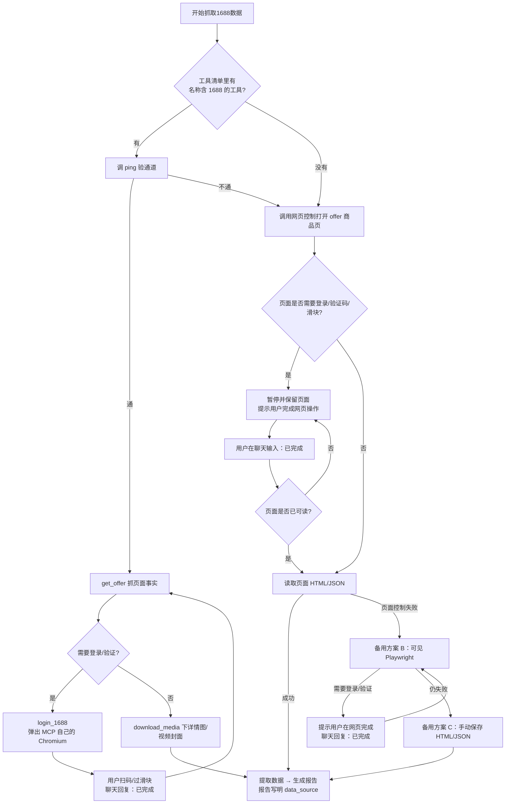

## R01 M2 新案九步执行（旧案原进度）

执行S1前先按 `scripts/s1_roadmap.py` 解析真实产品根：新案 `r01.m2` 必须读 `templates/s1_m2_execution.md`，按新九步的需求门、定位确认、全图CT和页面数据先算规则执行；旧案 `legacy.m1` 保留原步骤、编号和门禁，不自动迁移。旧正文的第6步回填等待只属于legacy.m1，不能覆盖新版5→6异步厂家确认。所有用户决定绑定真实user_reply，不把本文或脚本默认值写成用户授权。M1紧凑落盘、原生字节与immutable decision/proof继续生效。

## 统一资料接入约束（00C，必读）

开始本 Skill 前，若当前产品 run 存在 00C 资料接入报告或 Overlay，必须先读它们，应用其中的可用来源、事实边界、合规约束和外部数据补数计划；再读取本任务产物并执行。用户已提供未整理资料但没有 00C 时，先执行资料接入，不要求用户整理。读取 ../../templates/data_intake_read_contract.md 作为权威规则。

## 出品与归属（实战版）

| 项 | 内容 |
|---|---|
| 发行 | **实战版**（发布标签 **2026-08-01**） |
| 作者 | **坚哥** |
| 公众号 | **跨境者说干货** |
| 知识星球 | **星空的跨境圈子** |
| 运行环境 | **OpenAI Codex**（`~/.codex/skills`） |
| 包路径 | 随「星空亚马逊 Agent」插件分发（`skills/` 目录） |

> 打开本文件即可确认作者与来源；转载或改装请保留本表。

---

# 1688 产品详情页数据抓取 Skill（高级采购经理版）

> **星空 V2 硬规则（先读 `templates/1688_mcp_policy.yaml`）**  
> 抓页必须走本地 MCP `1688_scraper`，能力强于本 Skill 自己开网页。  
> 本 Skill **辅助或取代**旧的网页半辅助：MCP 抓事实，本 Skill 写 `03_1688产品资料_*.md`。  
> 生产模式 `ping` 不通就停，去装 `<plugin>/mcp/1688/`。禁止把网页半辅助写成默认。

## 我的身份（Senior Sourcing Manager）
我是每天在1688和工厂一线摸爬滚打的资深采购经理。不是简单抓数据，我看的是：
- 这个货能不能打造成亚马逊可规模化卖的产品（而非只是好看的数据）
- 供应商真实履约能力（不是看牛头标、成交额那么简单，要看复购率、退换率、实际发货稳定性）
- 哪些属性对亚马逊Listing最有价值（亚目数据往往藏在图片和参数表里，决定转化和合规）
- 成本结构和潜在坑（起批量、混批条件、头程+认证后的真实落地价）

我每天干的事就是把杂乱的1688页面，变成结构化的“Amazon上架决策包 + 采购执行包”，让团队能直接用，不返工。

**网页半辅助策略**：我先调用浏览器控制打开已校验的 offer 商品页。页面遇到登录、验证码或滑块时，我把状态写成 `waiting_1688_login` 或 `waiting_1688_verification`，暂停数据读取，并提示用户在弹出的商品网页完成操作；用户在聊天窗口输入 **“已完成”** 后，我复用当前页面继续检查和抓取。

网页可读后再提取页面 HTML/JSON、SKU、价格、件重尺、详情内容和媒体；“已完成”只表示用户已完成网页操作，不等于数据已经抓取成功。

## 策略叠层（实战版）

若 state 中存在 enterprise/category profile 或 overlay，则先读 enterprise supplier rules、category required attributes 与 `skill_patches/product_detail_scraper.md`，按 Core < Category < Enterprise < Product Run 调整抓取重点；无叠层走默认流程。企业历史参数不得写成当前商品事实。报告头部写 `profile_mode`、企业/类目、overlay version 与规则来源。

## 什么时候该找我（Triggers）
### 独立使用（Standalone）
- 你拿到一个或多个1688链接，想快速判断“值不值得推进到亚马逊”
- 需要完整的产品属性、变体、价格阶梯、图片视频、供应商信息、包装细节

### 场景联动（Workflow）
- **场景 A 新品上架速通**：第1步核心，我负责把1688原始信息打磨成可直接给市场调研和文案用的素材。
- **场景 D 供应链调研**：主力，我输出的是供应商评估 + 成本测算 + 风险判断的输入包。

**网页操作提醒**：登录/滑块在 **MCP 自己的 Chromium** 里完成（不是 Codex 内置浏览器）。完成后在对话回「已完成」。

## Prerequisites（星空 V2：MCP 必装）

- **生产：必须已配置 `1688_scraper`。** `ping` 通 → 无确定 offer_id 先 `search_offers(keyword)` 拿真实列表 → `get_offer` → 需要时 `login_1688` → `download_media`。返回 `not_offer_page`/`offer_missing` 说明 ID 编造或失效：不重试，回 search_offers 重选。
- 本 Skill 把 MCP 结果写成规范报告，落盘 `S1_选品板块/1688-product-detail-scraper/`。
- **仅演示**且用户声明没装 MCP → 才允许网页半辅助，并标 `source_fallback`。
- ⛔ 不得 MCP 抓一半改用 Codex 内置浏览器再试。

**两条路字段口径相同。** 报告写 `data_source: 1688_scraper(MCP)` 或 `data_source: 网页半辅助`。

⛔ **不因为走了哪条路而降低事实标注要求**；报告里必须写清 `data_source` 是哪条。

- 浏览器控制优先使用 `browser:control-in-app-browser`；如果当前运行环境选择了其他可见浏览器，仍必须保留可继续的页面上下文。
- 未完成登录/验证时不得读取或猜测商品事实，不得把等待状态写成抓取成功。
- 页面可读后的降级：浏览器页面 HTML/JSON → Playwright 可见浏览器 → 手动保存 HTML/JSON。
- 前置：以 `{产品根}`（Codex 打开的产品文件夹，`workflow_state.yaml` 所在层）为工作目录。本 Skill 的报告与抓取媒体**全部写进** `{产品根}/S1_选品板块/1688-product-detail-scraper/`（下文简称 `{本夹}`），媒体放其 `媒体/` 子夹；日期用 YYYYMMDD。

### ⛔ 三条防风控硬规则（v3.7.0，实测烧掉 45 分钟换来的）

**实测事故**（2026-07-28）：抓一个 offer 页耗时约 45 分钟，全程没拿到任何数据。
保存下来的 `1688_source.html` 只有 2.4 KB，内容是
`detail.1688.com/_____tmd_____/punish` —— 1688 的反爬拦截页，图片 URL 数为 0。
Skill 不认识这个页面，一直在"恢复抓取会话"，无限重试。

**三条规则，任何一条都不得违反：**

```
⛔ 同一 offer 页最多重试 1 次
⛔ 检测到 URL 或页面内容含 _____tmd_____/punish → 立即停止，换新标签页重开
⛔ 不得在多种浏览器通道之间来回切换 —— 这本身就是触发风控的原因
```

**第三条是当晚的真凶。** 实际发生的路径是：

```
Chrome 扩展通道（报"已在可见窗口打开"，实际没有窗口）
  → 本机 Chrome（又试一次）
  → 内置浏览器（这次成了）
反复请求同一个 offer + 通道特征跳变 → 1688 判定为爬虫 → punish 页
```

后来在**全新干净会话里一次打开内置浏览器**，直接读通，未触发任何验证码。
**说明这条路本身没问题，问题是重试和切换。**

**必须报真话**：启动不了可见窗口时，直接写"启动失败"，
⛔ **不得报成"已打开"**。误报比失败更贵 —— 用户看不到窗口却被告知已打开，
会白白多耗好几轮来回。

**风控命中后的正确动作**：

| 情况 | 做什么 |
|---|---|
| 首次命中 punish | 换新标签页重开一次（这是允许的那 1 次重试） |
| 再次命中 | 停止抓取，写 `blocked_reason=risk_control_punish`，提示用户稍后换干净会话再试 |
| 用户已有渲染好的可见页面 | 从**渲染后的 DOM** 读，不要再走源码通道（源码通道不带登录态） |

⛔ 页面事实是补充，不是必要前置。**卡在这一步不值得** ——
报价单已有价格、重量、包装尺寸，标 `waiting_1688_page_fact` 继续往下跑。

**课堂场景**：多人同时抓同一个 offer 必定触发风控。
课堂演示这一步应**只讲不跑**，用预先抓好的结果，并说明原因。

**课堂/学员提示**：课堂演示先看商品网页如何弹开，再演示登录/验证码人工完成与“已完成”续跑；不要把内部抓取器配置写进分享口令。

## 核心设计理念

> 本 Skill 的输出不仅仅是"采集 1688 数据"，而是**为亚马逊产品上架和文案撰写准备完整素材**。
>
> 报告分为三大模块：
> 1. **Amazon 上架数据卡**（报告最前面）— 直接可用于 Listing 撰写
> 2. **1688 原始采购数据**（报告中段）— 用于供应商评估和采购决策
> 3. **供应商补充数据接口**（报告末尾 + 可选独立清单）— 给用户找小二补真实数据，回填成本、包装、认证和可用于出图的原始视觉素材

## 技术原理

1688 商品详情页采用**服务端渲染（SSR）**，在 HTML 源码的 `<script>` 标签中嵌入了 `window.context` 变量，
包含完整的商品 JSON 数据（标题、价格、SKU、图片、供应商等）。

因此，**一次 HTTP GET 请求就能拿到全部结构化数据**，无需浏览器渲染或 JavaScript 执行。

---

## Workflow（完整工作流程）

### Step -1：输入链接校验（先于登录和抓取）

1. 只接受 offer 级商品详情链接：https://detail.1688.com/offer/{数字}.html，允许附加查询参数；从路径提取 offer_id，并在数据源日志中保留原始 URL 与规范化 URL。  
2. 上游只提供 shop URL 时，不能把它直接送进抓取器：先回到 supplier 步骤自动进店定位同款 offer 商品页。若页面出现验证码、登录或人工验证，写 waiting_1688_verification 并保留页面；验证后继续发现。  
3. 若输入是店铺主页、搜索结果页、短链、offer_id 缺失或 URL 无法验证，不启动浏览器、登录、HTTP 或 Playwright 抓取。只在已完成进店发现仍无商品页时写 waiting_1688_offer_url（格式错误则 invalid_1688_offer_url）。  
4. 不得从店铺 URL、商品标题或搜索卡片推导 / 拼接 offer_id；这会把错误商品的素材、SKU 和价格带入后续 Listing、视觉与财务。`search_offers` 工具返回的 offer_id 来自真实商品链接，可直接使用。  
5. 上游 supplier_handoff.status=ready_for_product_scrape 时，优先消费其中已校验的 selected_offer_url / selected_offer_id；状态为 waiting_1688_verification 时只提示继续店铺验证，不能声明已完成商品抓取。  

### Step 0：准备工作

1. 从用户提供的链接中提取商品 ID（URL 中 `offer/` 后面的数字串）
2. 获取当前日期，格式为 `YYYYMMDD`（如 `20260526`）
3. 确认 `{产品根}`（Codex 打开的产品文件夹，即 `workflow_state.yaml` 所在层；板块夹缺失时由总控先跑 `init_stage_folders.py`），准备输出目录 `{本夹}/媒体/`（即 `{产品根}/S1_选品板块/1688-product-detail-scraper/媒体/`）。本步之后所有 shell 命令均以 `{产品根}` 为工作目录执行，命令里的相对路径才成立；给 MCP 的 `save_dir` 一律传**绝对路径**（MCP 进程的工作目录不是产品根）。

---

### Step 0 · 先探测走哪条路（⛔ 不许跳过；生产必须 MCP）

先读 `<home>/templates/1688_mcp_policy.yaml`。

**星空 V2：本地 MCP `1688_scraper` 是抓页主路径，本 Skill 辅助或取代自己开网页。**

| 条件 | 走哪条 |
|---|---|
| 工具清单里存在名称含 `1688` 的工具（注册名 `1688_scraper`）且 `ping` 通 | **Step 0-A · MCP 主路径（生产必走）** |
| 生产模式：没有该工具，或 `ping` 不通 | **停。** 指引用户按插件 `mcp/1688/★先读我.md` 安装。禁止假装已抓到页面，禁止自动转 0-B。 |
| 仅当用户明确说「演示、没有 1688 MCP」 | **Step 0-B · 网页半辅助（演示回落）** |

探测口径：**按工具名含 `1688` 判断，先调一次 `ping` 验通道**，通了再往下。

> ⛔ **分支一次定死，跑中不许换。** MCP 用的是它自己的 Chromium，
> 网页半辅助用的是 Codex 内置浏览器 —— **这是两个不同的浏览器通道**，
> 而本 Skill 的防风控硬规则第 ③ 条就是「不得在多种浏览器通道之间来回切换」。
> 已走 MCP 的 → 登录问题只能用 `login_1688` 在同一个 Chromium 里解决，
> **不得改用网页半辅助去"再试一次"**。抓不到就标 `waiting_1688_page_fact`
> 往下跑 —— **换通道比抓不到更糟。**

> ⛔ **探测结果要写进报告**：生产必须是 `data_source: 1688_scraper(MCP)`。
> 演示回落才写 `data_source: 网页半辅助`。**两条路产出的字段口径完全相同**。

---

### Step 0-A · 1688 MCP 主路径（生产必走）

`1688_scraper` 提供 `ping` / `login_1688` / `get_offer` / `download_media`（另有 `search_offers` 关键词搜 offer，供应商短名单阶段可用，本 Skill 不依赖它）。
本 Skill **不自己开网页**；MCP 抓事实，本 Skill 写规范报告。

1. **验通道** —— 调 `ping`。生产模式不通则停并指引安装 `mcp/1688/`，**不要转 Step 0-B**。
2. **抓页面事实** —— 调 `get_offer`：
   - `offer_id`：从用户给的链接里取出 offer 数字 ID（形如
     `detail.1688.com/offer/828851649557.html` → `828851649557`）。
   - `save_dir`：`{本夹}/媒体/` 的**绝对路径**（如 `D:\产品\犬用雨衣\S1_选品板块\1688-product-detail-scraper\媒体`）。传相对路径会被 MCP 解析到它自己的安装目录，文件就丢了。
   - 返回 `window.context` 解析结果 + 媒体 URL 清单，并落一份 JSON。
3. **要登录时** —— `get_offer` 报需要登录，或状态为
   `waiting_1688_login` / `waiting_1688_verification` 时：
   - 调 `login_1688`。**会弹出 MCP 自己的 Chromium 窗口**
     （不是 Codex 内置浏览器，也不是系统默认浏览器 —— 跟用户说清楚是哪个窗口）。
   - 提示用户：**“已弹出 1688 登录窗口，请在那个窗口扫码登录 / 过滑块；
     完成后在这里回复：已完成。”**
   - 收到 **“已完成”** 后重新调 `get_offer`，不得猜测数据。
   - 登录态留在该包的 `pw_user_data/`，**下次一般不用再登**。
4. **下媒体** —— 调 `download_media`：
   - `json_path`：上一步 `get_offer` 落的 JSON 路径。
   - `save_dir`：同上，`{本夹}/媒体/` 的绝对路径；`max_files` 默认 80。
   - 它会再请求 `description.fields.detailUrl`，**详情长图进 `详情图/`、
     视频封面进 `视频封面/`；封面不冒充详情图。**
5. 拿到页面事实后，**跳过 Step 1（保存源码）**，直接进 Step 2 解析
   —— MCP 已经把 `window.context` 取出来了，不用再 curl 一遍。

**这条路快在哪：** 不用人工存 HTML、不用每次过验证码（登录态复用），
S1 第 5 步「去 1688 抓页面事实」从几分钟的人工操作压到一次工具调用。

---

### Step 0-B · 网页半辅助（仅演示回落，不是默认）

**生产禁止走这条。** 只有用户明确说「演示、没有 1688 MCP」才允许。
调用 `browser:control-in-app-browser` 打开已校验的 offer 商品页，保留可继续的浏览器页面上下文。
并标 `source_fallback=网页半辅助`。

1. 页面出现登录页或登录拦截时，写 `blocked_reason=waiting_1688_login`，暂停读取。
2. 页面出现验证码、滑块或人工验证时，写 `blocked_reason=waiting_1688_verification`，暂停读取。
3. 向用户提示：**“1688 商品网页已打开，请在网页完成登录/验证码/滑块；完成后在这里回复：已完成。”**
4. 收到用户的 **“已完成”** 后，复用当前页面重新检查 URL、页面可读性和 `window.context`；仍被拦截时继续保持等待状态，不得猜测数据。
5. 页面可读后保存页面 HTML/JSON，再进入 Step 1/Step 2 解析、分析、媒体下载和报告流程。

### Step 0.5 · 策略叠层（若有）

- 读取 `category_profile.yaml` / `playbook_overlay.yaml` 的 required attributes、材质、规格和合规提示。
- 若当前 run 存在 `00_总控/starsky-fullchain-workflow/runtime_data_overlay.yaml`，只读取其中 S1 指向的 supplier/compliance/sop 文件；将其作为“本轮待验证字段”和询盘重点，不当作页面已确认事实。
- 抓取时优先保存叠层要求的字段和垫图角度；缺失项进入报告的“待供应商确认清单”。
- 叠层不得覆盖事实来源规则：页面未确认的数据继续标注 `AI推断`。

---

### Step 1：保存可读页面源码（网页主路径）

优先从浏览器页面读取 HTML/JSON 并保存到本地文件，然后直接读文件。若浏览器控制无法导出页面，再用可见 Playwright 或手动保存作为降级，不将未验证的 HTTP 返回当作登录后的页面事实：

```powershell
curl.exe -L -A "Mozilla/5.0 (Windows NT 10.0; Win64; x64)" "{用户提供的1688链接}" -o "S1_选品板块/1688-product-detail-scraper/媒体/1688_source.html"
```

抓取完成后直接读取 `1688_source.html` 的内容进行解析。

---

### Step 2：解析 `window.context` 中的 JSON 数据

从 HTML 源码中找到 `window.context=` 开始的 `<script>` 块，提取其中嵌入的 JSON 数据。

数据藏在这个结构里：
```javascript
window.context = (function(b, d) { ... })("/default", { "result": { "data": { ... } } });
```

第二个参数就是完整的商品数据 JSON。


#### 核心数据字段路径（JSON）

| 数据 | JSON 路径 |
|------|-----------|
| **商品标题** | `result.data.gallery.fields.subject` |
| **商品 ID** | `result.data.gallery.fields.offerId` |
| **主图 URL 列表** | `result.data.gallery.fields.mainImage[]` |
| **全部图 URL 列表** | `result.data.gallery.fields.offerImgList[]` |
| **商品视频 URL** | `result.data.gallery.fields.video.videoUrl` |
| **视频封面图** | `result.data.gallery.fields.video.coverUrl` |
| **价格阶梯** | `result.data.mainPrice.fields.priceModel.currentPrices[]` |
| **价格区间** | `result.data.mainPrice.fields.finalPriceModel.tradeWithoutPromotion.offerPriceDisplay` |
| **最低价** | `result.data.mainPrice.fields.finalPriceModel.tradeWithoutPromotion.offerMinPrice` |
| **最高价** | `result.data.mainPrice.fields.finalPriceModel.tradeWithoutPromotion.offerMaxPrice` |
| **起批量** | `result.data.mainPrice.fields.finalPriceModel.tradeWithoutPromotion.offerBeginAmount` |
| **SKU 属性** | `result.data.Root.fields.dataJson.skuModel.skuProps[]` |
| **SKU 库存映射** | `result.data.Root.fields.dataJson.skuModel.skuInfoMap` |
| **件重尺** | `result.data.productPackInfo.fields.pieceWeightScale.pieceWeightScaleInfo[]` |
| **产品属性/参数** | `result.data.productAttributes.fields` |
| **公司名称** | `result.data.Root.fields.dataJson.tempModel.companyName` |
| **卖家登录名** | `result.data.Root.fields.dataJson.tempModel.sellerLoginId` |
| **全网销量（文字）** | `result.data.productTitle.fields.saleNum` |
| **全网销量（数字）** | `result.data.Root.fields.dataJson.tempModel.saledCount` |
| **商品评分** | `result.data.productTitle.fields.rateInfo.goodsGrade` |
| **好评率** | `result.data.productTitle.fields.rateInfo.goodRates` |
| **评价总数** | `result.data.productTitle.fields.rateInfo.commonTagNodeList[0].count` |
| **评价印象标签** | `result.data.productTitle.fields.rateInfo.impressionTagNodeList[]` |
| **店铺类型** | `result.data.productTitle.fields.shopInfo.cardType` |
| **卖家服务评分** | `result.data.productTitle.fields.shopInfo.sellerSlrServiceScore` |
| **复购率** | `result.data.productTitle.fields.shopInfo.byrRepeatRate3m` |
| **发货地** | `result.data.shippingServices.fields.location` |
| **运费** | `result.data.shippingServices.fields.totalCost` |
| **发货承诺** | `result.data.shippingServices.fields.deliveryLimitText` |
| **买家保障服务** | `result.data.shippingServices.fields.protectionInfos[]` |
| **详情描述页 URL** | `result.data.description.fields.detailUrl` |
| **是否跨境商品** | `result.data.Root.fields.dataJson.offerModelSign.isCrossBorderOffer` |
| **是否支持混批** | `result.data.Root.fields.dataJson.offerModelSign.isSupportMix` |
| **混批条件** | `result.data.Root.fields.dataJson.mixModel` |
| **店铺链接** | `result.data.Root.fields.dataJson.offerBaseInfo.sellerWinportUrl` |
| **商品标签** | `result.data.productTitle.fields.labels[]` |
| **商品认证标签** | `result.data.productTitle.fields.tagList[]` |
| **促销/优惠券** | `result.data.mainPrice.fields.promotionData` |
| **预定交期** | `result.data.Root.fields.dataJson.reserveData` |
| **商品类目 ID** | `result.data.Root.fields.dataJson.offerBaseInfo.catId` |

---

### Step 3：获取详情描述

如果 `detailUrl` 不为空，再次用 shell（curl 或 python requests）抓取详情描述内容并保存到本地文件后直接读取：

```powershell
curl.exe -L -A "Mozilla/5.0 (Windows NT 10.0; Win64; x64)" "{detailUrl}" -o "S1_选品板块/1688-product-detail-scraper/媒体/1688_detail.html"
```

详情描述中可能包含：产品规格参数表、材质说明、使用场景图、包装清单等对 Amazon Listing 极为重要的信息。

---

### Step 4：下载商品图片和视频

使用 PowerShell `Invoke-WebRequest` 批量下载：

**主图下载**（保存到 `{输出目录}/主图/`）：
```powershell
Invoke-WebRequest -Uri "{图片URL}" -OutFile "{输出目录}/主图/main_01.jpg" -UseBasicParsing
```

**详情图下载**（保存到 `{输出目录}/详情图/`）：
```powershell
Invoke-WebRequest -Uri "{图片URL}" -OutFile "{输出目录}/详情图/detail_01.jpg" -UseBasicParsing
```

**视频下载**（如有）：
```powershell
Invoke-WebRequest -Uri "{videoUrl}" -OutFile "{输出目录}/product_video.mp4" -UseBasicParsing
```

> [!TIP]
> 图片和视频可并行下载，提升效率。下载失败的项记录 URL 后跳过，不阻断流程。


### Step 5：AI 深度分析 — 提取 Amazon 上架关键数据

> [!IMPORTANT]
> 这是本 Skill 的核心差异化步骤。在完成原始数据提取后，AI 必须对所有收集到的数据进行深度分析，
> 提取/推断以下亚马逊上架必需的产品维度信息。

根据已抓取的所有数据（标题、SKU、件重尺、产品属性、详情描述、评价印象标签），AI 需要分析并明确填写以下字段：

#### 5.0 先生成逐字段上架事实，不等待供应商

抓取完成后立即把页面 JSON、标题、SKU、价格阶梯、件重尺、属性、详情 HTML、图片/OCR、视频信息和评价中的可用字段全部摘取到 `S1_选品板块/1688-product-detail-scraper/03_extracted_listing_facts.yaml`。供应商补充是校正层，不是启动提取的前置条件。

每个字段使用统一结构：

```yaml
material:
  value: "页面可见值或 null"
  source_status: "page_confirmed | media_derived | ai_inferred | missing"
  evidence: "JSON路径 / 详情图文件 / OCR文字 / 报告段落"
  confidence: "high | medium | low | none"
  allowed_use: "listing_ready | conditional_draft | internal_simulation_only | blocked_claim"
  revision_trigger: "供应商材质证明或样品确认"
```

必须覆盖：产品通用品名、材质、产品尺寸/可调范围、净重、包装尺寸/毛重、颜色/规格/SKU、套装数量、内容物、采购价/MOQ/库存信号/交期、用途、场景、人群、对象、使用方式、结构卖点、合规证据、媒体和可见评价信号。

若图片或详情能支持“外观为白色塑料、存在短/长款、可横纵组合”等观察，可标 `media_derived` 并用于条件性草稿；不能因为缺 PP/ABS 证明就把整个材质/结构模块删掉。未证实的性能声明仍为 `blocked_claim`。

#### 5.1 产品基础属性（必须明确）

| 维度 | 说明 | 数据来源优先级 |
|------|------|----------------|
| **产品名称（中文）** | 简洁通用品名，非营销标题 | 从标题提炼 |
| **产品名称（英文）** | Amazon 搜索用英文品名 | AI 翻译 |
| **产品材质** | 主体材质、面料成分（如 ABS塑料、不锈钢、涤纶等） | productAttributes > 详情描述 > 标题关键词 > AI 从图片推断 |
| **产品尺寸** | 长×宽×高，单位 cm 和 inch 双标注 | pieceWeightScale > productAttributes > 详情描述 |
| **产品重量** | 净重，单位 g 和 oz/lb 双标注 | pieceWeightScale > productAttributes |
| **包装尺寸** | 含包装的外箱尺寸 | pieceWeightScale（通常就是包装尺寸） |
| **可选颜色** | 所有可用颜色列表 | skuProps 中 fid=3216 或 prop="颜色" 的 value |
| **可选规格/型号** | 尺码、版本、插头类型等变体 | skuProps 中非颜色的属性 |
| **包装内容物** | 用户收到的所有物品清单（如：主机×1、说明书×1、收纳袋×1） | 详情描述 > AI 从图片推断 |
| **电压/功率** | 如适用（电器类） | productAttributes > 详情描述 > 标题 |
| **认证/标准** | CE、FCC、ROHS、UL 等 | productAttributes > 详情描述 > tagList |

#### 5.2 产品使用维度（必须明确）

| 维度 | 说明 | 数据来源优先级 |
|------|------|----------------|
| **产品用途** | 这个产品是做什么用的？（如：熨烫衣物、去除褶皱、杀菌消毒） | 标题关键词 + 详情描述 + 评价标签 |
| **使用场景** | 在什么场景下使用？（如：家用日常、出差旅行、办公室、宿舍） | 标题关键词（"家用"、"便携"等）+ 详情描述 |
| **目标用户/使用人群** | 谁会买？（如：上班族、家庭主妇、学生、旅行者、租房年轻人） | 标题暗示 + 使用场景推断 + 评价分析 |
| **使用对象** | 用在什么东西上？（如：衣服、窗帘、床单、西装） | 产品类目 + 标题 + 详情描述 |
| **使用方式** | 怎么用？（如：手持操作、挂烫/平烫两用、加水即用） | 详情描述 + 标题关键词 |

#### 5.3 产品卖点提炼（必须明确）

AI 需要从以下维度综合分析，提炼出 **5-8 个核心卖点**：

| 卖点来源 | 分析方法 |
|----------|----------|
| **买家评价印象标签** | 高频正面标签直接反映用户最认可的卖点（如"物流很快" → 发货速度、"质量很好" → 品质可靠） |
| **1688 标题关键词** | 标题中的功能词是卖家主推的卖点（如"大容量"、"便携式"、"蒸汽刷"） |
| **产品属性/参数** | 突出的技术参数（如大功率、大水箱、快速加热） |
| **详情描述** | 厂家自述的产品优势 |
| **SKU 多样性** | 多颜色/多规格本身就是卖点（如"5种插头标准，覆盖全球市场"） |
| **供应商资质** | 源头工厂、1688严选等标识增强品质背书 |

每个卖点需要包含：
- **卖点标题**（中文，4-8字，简洁有力）
- **卖点标题**（英文，用于 Amazon Bullet Point 标题）
- **卖点描述**（中文，1-2句话展开说明）
- **卖点描述**（英文，用于 Amazon Bullet Point 正文）
- **数据支撑**（来自哪个数据字段或买家评价）

#### 5.4 Amazon 搜索关键词提取

从标题、属性、评价中提取中英文搜索关键词：

- **核心关键词**（3-5个）：产品品类词（如 garment steamer, clothes steamer）
- **长尾关键词**（5-10个）：带修饰的搜索词（如 portable handheld steamer for clothes）
- **属性关键词**（5-10个）：材质、功能、场景词（如 travel, wrinkle remover, 1500W）

---

### Step 6：生成结构化 Markdown 报告

将所有数据整理成标准 Markdown 文件，保存到输出目录。

**报告文件名**：`03_1688产品资料_{商品ID}.md`，写入 `{本夹}`（`{产品根}/S1_选品板块/1688-product-detail-scraper/`）。

> 编号规则：供应商短名单使用 02；首选商品详情与供应商事实使用 03 号段。不得输出无编号的同名报告。


**报告模板**：

> [!IMPORTANT]
> 报告模板的核心原则：**Amazon 上架数据卡放在最前面**，因为这是用户最常用的部分。
> 1688 原始采购数据放在后半部分作为参考。

```markdown
# 1688 产品数据报告 — {商品标题}

> **抓取时间**: {当前日期时间}
> **商品 ID**: {商品ID}
> **来源链接**: {原始URL}

---

# 📦 Part A：Amazon 上架数据卡

> 以下数据专为 Amazon Listing 撰写准备，可直接用于产品文案。

## A1. 产品基础信息

| 维度 | 中文 | 英文 |
|------|------|------|
| **产品名称** | {中文品名} | {English Product Name} |
| **产品材质** | {材质描述} | {Material} |
| **产品尺寸** | {长×宽×高 cm} | {L×W×H inch} |
| **产品重量** | {净重 g} | {净重 oz/lb} |
| **包装尺寸** | {长×宽×高 cm} | {L×W×H inch} |
| **包装重量** | {含包装重量 g} | {含包装重量 oz/lb} |
| **电压/功率** | {如适用} | {如适用} |
| **认证标准** | {CE/FCC/ROHS 等} | {同左} |

## A2. 可选变体

### 颜色选项
{列出所有颜色，附 SKU 图片}

### 规格/型号选项
{列出所有规格变体，如插头类型}

## A3. 产品用途与适用场景

| 维度 | 内容 |
|------|------|
| **产品用途** | {具体用途列表} |
| **使用场景** | {使用场景列表} |
| **目标用户 / 使用人群** | {目标用户画像} |
| **使用对象** | {用在什么东西上} |
| **使用方式** | {怎么用} |

## A4. 包装内容物（What's in the Box）

{编号列出包装内每一项物品}

## A5. 核心卖点（Selling Points）

> 以下卖点可直接用于 Amazon 五点描述（Bullet Points）的撰写素材。

### 卖点 1：{中文卖点标题} / {English Selling Point Title}
- **中文描述**：{1-2句展开}
- **English**：{1-2 sentences for Bullet Point}
- **数据支撑**：{来源}

### 卖点 2：...
{重复以上格式，共 5-8 个卖点}

## A6. Amazon 搜索关键词建议

### 核心关键词（Core Keywords）
{3-5个，中英文对照}

### 长尾关键词（Long-tail Keywords）
{5-10个，英文为主}

### 属性关键词（Attribute Keywords）
{5-10个，材质/功能/场景词}

## A7. 买家评价洞察（来自 1688 买家反馈）

| 评价标签 | 提及次数 | 对 Amazon Listing 的启示 |
|----------|----------|--------------------------|
| {标签1} | {次数} | {如何转化为卖点或文案} |
| {标签2} | {次数} | {启示} |
| ... | ... | ... |

---

# 🏭 Part B：1688 原始采购数据

## B1. 价格体系

| 采购量 | 单价 |
|--------|------|
| {阶梯1} | ¥{价格1} |
| ... | ... |

- **价格区间**: {offerPriceDisplay}
- **起批量**: {offerBeginAmount}
- **混批条件**: {mixModel}

## B2. SKU 库存明细

| {变体1} | {变体2} | 可预订数量 |
|---------|---------|------------|
| ... | ... | {canBookCount} |

## B3. 商品件重尺（全 SKU）

| 颜色 | 规格 | 长(cm) | 宽(cm) | 高(cm) | 体积(cm³) | 重量(g) |
|------|------|--------|--------|--------|-----------|---------|
| ... | ... | ... | ... | ... | ... | ... |

## B4. 供应商信息

| 项目 | 内容 |
|------|------|
| **公司名称** | {companyName} |
| **店铺名** | {sellerLoginId} |
| **所在地区** | {location} |
| **店铺类型** | {cardType} |
| **卖家服务评分** | {score} |
| **复购率** | {rate} |
| **店铺链接** | {url} |

## B5. 物流与服务

| 项目 | 内容 |
|------|------|
| **发货承诺** | {deliveryLimitText} |
| **运费** | ¥{totalCost} |
| **发货地** | {location} |

### 买家保障
{列出 protectionInfos}

## B6. 详情描述

{detailUrl 的内容}

## B7. 商品图片与视频

### 主图（已下载到 `主图/` 文件夹）
| 序号 | 本地文件 | 原始 URL |
|------|----------|----------|
| ... | ... | ... |

### 详情图（已下载到 `详情图/` 文件夹）
| 序号 | 本地文件 | 原始 URL |
|------|----------|----------|
| ... | ... | ... |

### 商品视频
| 文件 | 原始 URL |
|------|----------|
| ... | ... |

## B8. 商品标识汇总

| 标识 | 状态 |
|------|------|
| 跨境商品 | {是/否} |
| 支持混批 | {是/否} |
| 一件代发 | {是/否} |
| ... | ... |

---

# 🧾 Part C：供应商补充数据接口

> 页面抓不到或不足以支撑 Amazon 上架的数据，必须找 1688 小二/店家确认。以下内容可复制给供应商。

## C1. 必须补充的数据

| 类型 | 要问供应商什么 | 用于下游 |
|---|---|---|
| 材质 | 主体材质、表面处理、是否木质/金属/涂层、是否含玻璃/陶瓷 | IP、Listing、图片 |
| 尺寸重量 | 单品尺寸、净重、包装尺寸、毛重、外箱规 | FBA 费、利润测算 |
| 包装清单 | 是否含仿真绿植、干花、安装配件、说明书、螺丝/胶贴 | Listing、主图、A+ |
| 成本条款 | 阶梯价、MOQ、打样费、定制 MOQ、交期、混批、运费 | 供应商评估、ACOS |
| 跨境服务 | 贴标、箱唛、FBA 代发、英文说明书、包装定制 | 供应链决策 |
| 合规/质检 | 材质报告、检测报告、承重/安装测试、图片/视频授权 | IP、合规、视觉 |
| 出图原始素材 | 无字无水印原图（正面、45°、侧背、细节、包装、配件、安装/使用），对应变体和可用授权 | 主副图、A+、视频 |

## C2. 给小二的询盘话术

```text
你好，我们准备把这款产品做跨境电商上架，需要确认以下资料：
1. 请提供产品主体材质、表面处理、单品尺寸、净重、包装尺寸、毛重和外箱规。
2. 请确认包装清单：是否包含仿真绿植/干花、安装配件、说明书、螺丝或胶贴。
3. 请提供阶梯报价、MOQ、打样费、定制 Logo/包装 MOQ、生产交期和现货数量。
4. 是否支持贴标、箱唛、英文说明书、FBA 头程或代发？
5. 是否有材质检测报告、承重/安装测试资料、产品实拍图和视频授权？
6. 如果我们要做美国亚马逊，请说明哪些参数可以写在页面上，哪些需要实测后确认。
7. 请发送无文字、无水印的原始产品图：正面、45°、侧面/背面、关键细节、包装和全部配件；请标注图片对应的颜色/规格，并确认我们可用于 Amazon Listing、A+ 和广告素材制作。
```

## C3. 回填规则

- 小二回复后，不覆盖原报告；把回复放入当前产品 `00_产品资料/供应商回填/`、直接交给总控，或作为新文件补充到用户的资料包后重新索引。资料包源目录默认只读，生成 `03B_供应商数据合并与复算.md` + `03_product_facts.yaml`。
- 未拿到证据的字段不得写成 Amazon 前台承诺。
- 承重、防水、无痕安装、环保、无味、抗菌、防霉等必须有样品或报告支持。
```

---

### Step 6.5：建立原始媒体清单（视觉链必需）

在下载媒体后，必须在同一媒体根目录写出 `media_manifest.yaml`，它记录的是**1688 原始媒体**，不能和后续“产品垫图”混为一谈。每一项至少包括：

```yaml
- source_asset_id: "SRC-MAIN-01"
  relative_path: "主图/main_01.jpg"
  original_url: "https://..."
  media_type: "image"
  source_role: "main_image | sku_image | detail_image | video_cover"
  width_px: null
  height_px: null
  file_sha256: "..."
  selected_variant: "..."
  has_embedded_text_or_watermark: "unknown | yes | no"
  usable_for_visual_reference: "pending_review"
```

这个文件只列事实来源；是否适合主图、能支撑哪项卖点，由后续 `visual_asset_prepare` 复核决定。

### Step 6.8：生成供应商产品报告（可视化 HTML，必做）

**用户敲定意向供应商后，只对这一家** `download_media`（主图、SKU 图、详情图、视频与封面），再生成可视化报告，让用户在一页里看完这款产品。短名单里其他几家只用 `get_offer` 的文字数据比较，不下载图片、不出可视化报告：

```text
"<python>" "<home>/scripts/offer_report.py" --offer-dir "{本夹}/offer_{商品ID}" --facts "{本夹}/03_1688产品资料_{商品ID}.md"
```

- 产物：`{本夹}/offer_{商品ID}/供应商产品报告_{商品ID}.html`（左侧电梯导航；主图画廊、按页面顺序的完整详情页、产品视频、价格阶梯与 SKU、重量包装、工厂与评价、03 资料卡全文）。
- 图片压缩后内嵌，单文件可转发；视频体积大，按相对路径引用，报告与 `media/` 需放在一起。
- 页面没有视频（`gallery.video.videoId = 0`）时，报告明确写“该商品页面没有主图视频”；页面有视频但未下载，要重新 `download_media`，不能写成“无视频”。
- 只陈述页面事实，缺失字段写“页面未提供”；不补数、不推断。

### Step 6.9：产品 CT（选定款是什么、不是什么，必做）

意向款敲定后（最迟 S1 第 6 步供应商回填时，厂家没回也要做），把选定款像拍 CT 一样摸清楚。市场调研画像的 `materials` 是「市场上有哪些材质」，不是本品；S2 词库、S3 视觉、S4 否定词都读这份 CT。

```text
1. "<python>" "<本 Skill>/scripts/product_ct.py" --run "<产品根>" --init
   → {本夹}/03_product_ct.yaml（预填选定 offer、颜色、画像里的市场材质、03 事实里的材质线索）
2. 按 1688 标题 / 属性表 / 详情图 / 视频 / 厂家回复填：
   - material：main_cn + main_en（买家搜索说法，如 diatomite / diatomaceous earth）、部件材质、source_status 与 evidence
   - structure.mount：台面 / 壁挂 / 吸盘 / 粘贴 / 悬挂；features：本品真有的结构功能（en_terms）
   - 尺寸、重量、颜色、包装清单、适配对象（没摸清写 missing，不猜数）
   - not_this：本品不是的形态（wall mounted、suction…）和没有的功能（uv sanitizer…）；单一主材质时脚本自动把其他常见材质列入
3. "<python>" "<本 Skill>/scripts/product_ct.py" --run "<产品根>"
   → 03_产品CT.md + 03_product_ct_status.json；退出码 2 = 必须改（材质没写、安装方式没写、市场材质没判、自相矛盾）
```

- 材质只能看图推断时写 `image_inferred` / `ai_inferred`：词库照样挡冲突词，但 Listing 与图片不得把材质写成已验证。
- 用户或厂家后补材质、结构时，改 CT → 重跑本脚本 → 重跑 S2 `sif_clean.py`（词库按新 CT 重分池）。

### Step 7：输出总结

向用户汇报抓取结果：
1. 报告保存位置（**附上 `供应商产品报告_{商品ID}.html` 的可点击路径，提示用户先打开这一页看图片、详情和视频**）
2. Amazon 数据卡是否完整（哪些字段是确认数据，哪些是 AI 推断）
3. 哪些字段未获取到（附解释）
4. 下载了多少张图片、是否有视频
5. 如果有 AI 推断的字段，提醒用户核实
6. 输出 `03C_上架数据解释与续跑说明.md`：已确认、媒体推导、AI 推断、缺失字段、受限声明、当前续跑方式和后补数据的修订范围
7. 用户未补资料时，handoff 明确指示总控使用本事实卡生成 `03_product_facts.yaml` 和条件化 03B，不得停在供应商补充清单

### Step 7.5：数据解释窗口（不是审批窗口）

向用户展示：

```markdown
【数据解释窗口】
- 页面确认：SKU、价格、重量、库存/销量信号……
- 自动摘取：从详情图/OCR/标题提取的结构、场景与变体信息……
- 模拟使用：包装/FBA/头程采用的区间……
- 缺失限制：哪些字段不能写入 Amazon 前台……
- 当前方式：条件性续跑（不会停线）
- 后补入口：以后回复“补充数据：字段=值”，只修订受影响报告
```

用户回复“继续”或没有供应商回填时，默认 `deferred_auto_extracted`；将全部 `page_confirmed` 和合适的 `media_derived` 字段交给总控，`ai_inferred` 仅作条件性草稿/内部分析，`missing` 字段使用区间或限制声明。


---

## 备用方案 B：Playwright 自动化浏览器（网页控制不可用时）

> [!IMPORTANT]
> 当网页控制无法继续或需要更深的可见浏览器自动化时使用本方案。Playwright 会启动一个**可见的浏览器窗口**，并复用用户已有的 Chrome 登录态；仍须先让用户完成登录/验证并回复“已完成”。

### 前置条件

- Python 3.10+ 已安装
- Playwright 已安装：`pip install playwright`
- 用户的 Chrome 浏览器**必须先完全关闭**（Playwright 需要独占 User Data 目录）

### 步骤

1. **生成并运行 Python 脚本**

在 `{本夹}/运行数据/` 创建 `pw_scraper.py`（过程脚本不算产物），内容如下：

```python
import json, os, sys, time
from playwright.sync_api import sync_playwright

TARGET_URL = "{商品链接}"
OUTPUT_FILE = "{输出目录}/product_{商品ID}.json"
# 复用用户已有的 Chrome 配置以保留登录态
CHROME_USER_DATA = os.path.expandvars(r"%LOCALAPPDATA%\Google\Chrome\User Data")

def main():
    with sync_playwright() as p:
        # 使用用户的 Chrome 配置启动，复用 1688 登录态
        context = p.chromium.launch_persistent_context(
            CHROME_USER_DATA,
            channel="chrome",
            headless=False,
            args=["--disable-blink-features=AutomationControlled"],
            viewport={"width": 1400, "height": 900},
        )
        page = context.pages[0] if context.pages else context.new_page()
        page.goto(TARGET_URL, wait_until="domcontentloaded", timeout=30000)
        time.sleep(5)

        # 检查是否需要登录
        if "login" in page.url.lower() or "signin" in page.url.lower() or "punish" in page.url.lower():
            print("需要登录！请在弹出的浏览器中手动登录 1688")
            for i in range(60):  # 最多等5分钟
                time.sleep(5)
                if "detail.1688.com/offer" in page.url:
                    print("登录成功，继续抓取...")
                    time.sleep(5)
                    break

        # 滚动页面触发懒加载
        page.evaluate("window.scrollTo(0, document.body.scrollHeight / 2)")
        time.sleep(2)
        page.evaluate("window.scrollTo(0, document.body.scrollHeight)")
        time.sleep(3)

        # 提取数据
        data = page.evaluate("window.context?.result?.data || null")
        if data:
            with open(OUTPUT_FILE, "w", encoding="utf-8") as f:
                json.dump(data, f, ensure_ascii=False, indent=2)
            print(f"SUCCESS: saved to {OUTPUT_FILE}")
        else:
            print("FAILED: window.context is empty")
        context.close()

if __name__ == "__main__":
    main()
```

2. **执行脚本**

```powershell
python S1_选品板块/1688-product-detail-scraper/运行数据/pw_scraper.py
```

3. **用户交互**

- 如果弹出的浏览器需要登录/验证码，**提示用户手动处理**
- 脚本会自动等待最多 5 分钟，检测到登录成功后自动继续
- 登录完成后自动提取 `window.context` 数据并保存为 JSON

4. **读取 JSON 继续生成报告**

脚本执行完后，直接读取输出的 JSON 文件，提取字段路径与方案 A 完全相同。
之后的 AI 分析、下载图片、生成报告步骤与方案 A 一致。

---

## 降级方案 C：手动网页另存解析（终极无依赖保障）

> [!IMPORTANT]
> 当自动网页抓取方式因滑块或网络环境失败时，可使用此人工降级方案。成功率仍取决于用户能否正常打开并保存页面，不承诺 100%。

### 步骤

1. **手动获取数据**
   - 在您的常用浏览器中手动打开该 1688 商品页面。
   - 方法一（完整网页）：右键选择“网页另存为”，将保存类型选为“仅 HTML”或“全部网页”，命名为 `1688_source.html`。
   - 方法二（纯 JSON）：按 `F12` 打开开发者工具，在 Console（控制台）输入 `copy(window.context.result.data)`，这会将商品 JSON 数据复制到您的剪贴板。在工作区新建一个 `1688_source.json` 文件并粘贴进去。

2. **放置在工作区**
   - 将保存好的 `1688_source.html` 或 `1688_source.json` 文件拖入工作区的任意位置（推荐拖入 `{本夹}/媒体/` 目录下）。

3. **AI 自动解析**
   - 告知 AI ：“我已经手动保存了 1688 数据源，请解析本地文件：[文件路径]”。
   - AI 会直接读取该本地 HTML/JSON 文件，从中提取数据，继续完成 Step 4 的图片/视频下载及后续的 Amazon 数据卡生成流程。

---

## Output（输出规范）

### 文件夹结构

⛔ **报告与媒体都写在本 Skill 夹内，媒体在 `媒体/` 子夹。** 不得把媒体写到产品根、`00_产品资料/`（那是用户投喂原件）或 Codex 打开的上级目录；否则报告内所有 `媒体/...` 相对引用全部断链。本 Skill 内所有路径一律以 `{产品根}` 为锚点，给 MCP 的 `save_dir` 传绝对路径。

> 实测反例（2026-08-02，旧布局）：报告落在 run 目录，媒体落在项目根，`workflow_state.yaml` 与 4 份报告里的 6 处媒体引用全部解析失败。新布局把两者放进同一个夹，就是为了根治这个问题。

```
{产品根}/                                   ← Codex 打开的产品文件夹
├── workflow_state.yaml
└── S1_选品板块/
    └── 1688-product-detail-scraper/         ← {本夹}
        ├── 03_1688产品资料_{商品ID}.md        ← 结构化数据报告（含 Amazon 上架数据卡）
        ├── 03_extracted_listing_facts.yaml    ← 从页面/媒体自动摘取的逐字段上架事实
        ├── 03A_供应商数据补充清单.md          ← 由总控或本 Skill 根据缺口生成
        ├── 03B_供应商数据合并与复算.md        ← 供应商回填后的合并与复算
        ├── 03C_上架数据解释与续跑说明.md      ← 缺数影响、模拟方式、后补修订入口
        ├── 03_product_facts.yaml              ← 合并后的产品事实（给 S2–S4 读）
        ├── 运行数据/                          ← 过程脚本、临时 JSON（不算产物）
        └── 媒体/
            └── {YYYYMMDD}_{商品标题简称}/
                ├── 1688_source.json           ← get_offer 落的页面事实
                ├── media_manifest.yaml        ← 1688 原始媒体来源清单
                ├── product_video.mp4          ← 商品视频（如有）
                ├── 主图/
                │   ├── main_01.jpg
                │   └── ...
                ├── 详情图/
                │   ├── detail_01.jpg
                │   └── ...
                └── 视频封面/                  ← 封面不冒充详情图
```

供应商回填的原件（报价单、规格书、小二聊天记录）属于用户投喂，放 `00_产品资料/供应商回填/`，不放本夹。

### 命名规则
- **文件夹名**：`{YYYYMMDD}_{商品标题前20字符}` — 日期在前方便排序
- **标题中的特殊字符**（空格、斜杠等）替换为下划线
- **图片编号**：从 01 开始，两位数补零

---

## 方案选择决策流程（MCP 快路径优先 → 网页半辅助回落）



## Error Handling（异常处理）

| 异常情况 | 处理方式 |
|----------|----------|
| 输入只是店铺 URL，且尚未完成进店发现 | 回到 supplier 自动进店查同款 offer；验证码时保留页面并写 waiting_1688_verification，不触发抓取或登录 |
| 输入不是可校验的 offer 级商品 URL | 已完成进店发现仍无结果时写 waiting_1688_offer_url；格式错误写 invalid_1688_offer_url，要求补 detail.1688.com/offer/{ID}.html |
| 抓取被拦截（返回登录页/空白/无 `window.context`） | 先写 `waiting_1688_login` 或 `waiting_1688_verification` 并暂停；用户回复“已完成”后复查同一页面；仍失败再按网页控制 → 可见 Playwright → 手动 HTML/JSON 降级 |
| Playwright 需要登录 | 脚本自动暂停，提示用户在弹出的浏览器中手动登录，最多等 5 分钟 |
| Playwright 无法启动（Chrome 未关闭） | 提示用户先完全关闭 Chrome，再重新运行脚本 |
| 页面加载超时 | 重试一次，若仍失败则告知用户 |
| `productAttributes` 字段为空 | 从详情描述、标题、图片中推断属性，在报告中标注"AI 推断" |
| 材质/用途等信息无法确认 | 在报告中标注"⚠️ AI 推断，请人工核实"，不留空 |
| 供应商没有回填 | 自动输出 extracted listing facts，按 `deferred_auto_extracted` 条件性续跑，不降级报告深度 |
| 图片/视频下载失败 | 记录失败 URL，跳过继续，在报告中标注 |
| 详情描述 URL 返回空 | 在报告中标记"详情描述未获取到" |

---

## AI 推断标注规范

> [!IMPORTANT]
> 在 Amazon 上架数据卡中，必须明确区分**确认数据**和 **AI 推断数据**。

- **确认数据**：直接从 JSON 字段中提取到的数据，无需标注
- **AI 推断数据**：基于标题、描述、评价、图片等间接推断的数据，必须在字段值后标注 `⚠️ AI推断`

示例：
```
| **产品材质** | ABS 工程塑料 + 不锈钢底板 ⚠️ AI推断 | ABS Plastic + Stainless Steel Soleplate |
```

这样用户可以快速识别哪些数据需要进一步确认。

---

## Notes（注意事项）

1. **方案优先级 网页半辅助 → 可见 Playwright → 手动 HTML/JSON**：先打开 offer 商品页并保留用户可操作的页面上下文；用户完成登录/验证并回复“已完成”后再抓取；方案 B 应对网页控制失败；方案 C 为终极兜底
2. **方案 B 使用前必须关闭 Chrome**：Playwright 的 `launch_persistent_context` 需要独占 User Data 目录，Chrome 运行时会冲突
3. **Playwright 首次使用需安装**：`pip install playwright`，无需 `playwright install`（直接使用系统已安装的 Chrome）
4. **不要过快连续访问**：批量抓取时每次间隔至少 5-10 秒，避免触发风控
5. **商品标题简称**：取标题前 20 个字符用于文件夹命名
6. **图片去重**：主图和详情图的 URL 需要去重，避免重复下载
7. **Amazon 数据卡是核心输出**：报告的 Part A 是最重要的部分，必须尽可能完整
8. **AI 推断要有证据且标注诚实**：标题/图片/详情能支持时可推断并写 evidence；无法支持时保留 missing，不为了填满字段编造
9. **1688 页面结构可能变化**：如果某天抓取失败，需重新分析 HTML 中的数据嵌入方式
10. **本 Skill 不包含任何私有商品信息**，可安全分享给其他用户使用

## 教学 / 交付建议（For Course）

**课堂演示重点**：
- 拿一个真实1688链接，现场演示商品网页弹开 → 用户完成登录/验证码 → 回复“已完成” → 抓取 → 生成双模块报告（Amazon数据卡在前）。
- 突出“亚目结构化数据”如何直接喂给文案和供应商评估。
- 展示降级方案 C（手动另存）作为“永远成功”的兜底，让学员知道网页控制不可用时仍能继续。

**学员最容易卡的点**：
- 忘记先在弹出的商品网页完成登录/验证码/滑块，或完成后没有在聊天中回复“已完成”。
- 混淆“原始数据”和“Amazon上架数据卡”——前者给采购，后者直接给Listing。
- 忘记在AI推断字段加“⚠️ AI推断”标注，导致学生以为全是真的。

**课后练习任务**：
1. 用一个自己正在考虑的1688链接跑一次网页半辅助流程，输出报告并标记哪些是推断。
2. 对比网页控制抓取与手动保存 HTML/JSON 的结果，写出3条数据质量差异。
3. 把 03_1688产品资料 与供应商回复交给总控生成 product facts，再由 amazon-market-research 更新成本测算。

**高级运营红线**：1688 抓取永远是场景 A/D 的起点。机器已经抓到的信息必须先自动摘取，不能再让用户重复提供；缺数据要限制错误承诺，而不是把后续完整分析全部卡死。用户完成网页验证后必须复用当前页面，不得把“已完成”冒充为已抓取成功；非关键字段缺失应通过解释窗口和条件性续跑处理。

### 0711 事实优先级与局部修订

运行前读取 `../../templates/evidence_decision_revision_contract.md`：

1. 每个 `03_extracted_listing_facts.yaml` 字段增加 evidence_id、source_ref、allowed_use 和 revision_trigger。
2. 当前 offer 的 SKU/属性/件重尺优先于市场阶段的规格假设；发生冲突时输出 `fact_conflicts`，后到高等级事实修订早期画像但保留旧值。
3. 供应商不回填时，页面已确认字段自动进入 product facts；只把确实缺少的性能/合规/包装字段列入补充清单。
4. 后补重量只修订财务、S1、广告等受影响产物；后补材质/性能只修订相关 IP、文案和视觉声明，不重跑无关词库。
5. 主图、详情图和视频只登记来源与可支持事实；素材使用权提示为 soft warning，内部演示不重复询问授权。

---
## 实战版 · 编排契约

### 版本
**3.9.0** starsky-v2 · 作者坚哥（本地 MCP `1688_scraper` 为生产必装主路径，
本 Skill 辅助或取代自己开网页；仅演示允许网页半辅助回落；字段口径相同，报告写明 `data_source`）

> **3.7.0 三条防风控硬规则继续有效**（实测烧掉 45 分钟换来）：
> ① 同一 offer 页最多重试 1 次；
> ② 命中 `_____tmd_____/punish` 立即停止并换新标签；
> ③ **不得在多种浏览器通道之间来回切换** —— 这本身就是触发风控的原因。
> 另加「启动失败必须报真话，不得报成已打开」，以及
> 「页面事实是补充不是前置，卡住就标 `waiting_1688_page_fact` 继续往下跑」。

> ⛔ **3.9.0 必读 —— 生产必须 MCP；分支一次定死，跑中不许换。**
> 第 ③ 条防风控规则在这里同样适用，而且更容易踩：
> **MCP 走的是它自己的 Chromium，网页半辅助走的是 Codex 内置浏览器 ——
> 这是两个不同的浏览器通道。**
> 生产：`ping` 不通就停去装 `mcp/1688/`，**不得自动转 0-B**。
> 已经开始走 MCP 的，中途遇到登录/验证码只能用 `login_1688` 在**同一个
> Chromium** 里解决，**不得改用网页半辅助去"再试一次"**。
> 抓不到就按原规则标 `waiting_1688_page_fact` 往下跑，**换通道比抓不到更糟**。

### 两条路径
- **Step 0-A · MCP 主路径（生产必走）**：`ping` → `get_offer` →（需要时 `login_1688`，
  登录态复用）→ `download_media`。不用人工存 HTML，跳过 Step 1。本 Skill 只写报告。
- **Step 0-B · 网页半辅助（仅演示）**：用户声明没有 MCP 时才允许；打开已校验的 offer 商品页；遇到登录/验证码/滑块时写
  `waiting_1688_login` 或 `waiting_1688_verification`，提示用户完成网页操作并回复“已完成”，再继续读取页面。

### 输出
`{产品根}/S1_选品板块/1688-product-detail-scraper/03_1688产品资料_{商品ID}.md` + 同夹 `03_extracted_listing_facts.yaml` / `03_product_facts.yaml` / `03C_上架数据解释与续跑说明.md` + 媒体目录（**写在本 Skill 夹内，不落产品根 `生成报告/`**）。报告末尾保留供应商补充接口；用户不补时也必须把可用字段交给总控条件性续跑。

### Handoff
```markdown
【本步完成】1688-product-detail-scraper
【下一步 Skill】
- amazon-ip-risk-assessment（沙龙 S 场景默认）
- amazon-market-research（如需先回填成本再复算）
- alibaba-supplier-evaluation（要继续比更多供应商时）
【推荐口令】继续。优先读取 03_extracted_listing_facts.yaml 自动生成 03_product_facts.yaml 与条件化 03B；如我提供供应商补充数据则合并修订，否则按 deferred_auto_extracted 继续进入 IP，并告诉我以后补数会修订哪些报告。
【网页状态】已打开 offer 商品页；如遇登录/验证码/滑块，用户完成后回复“已完成”，再继续抓取
```
